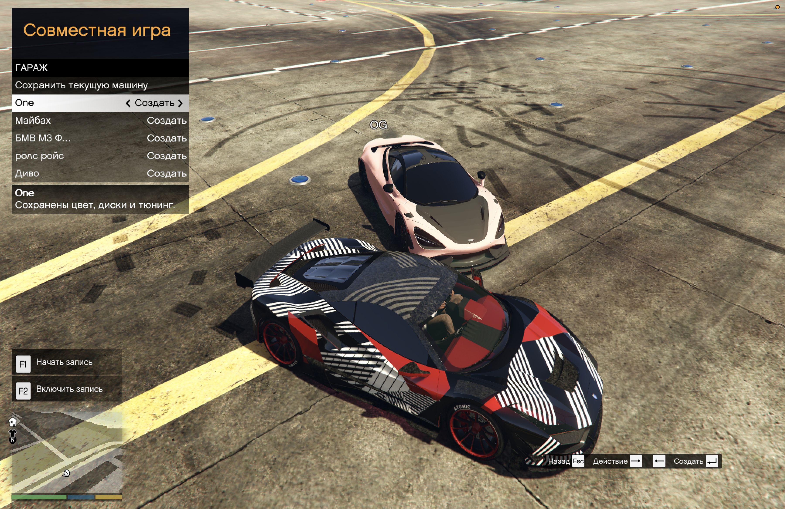
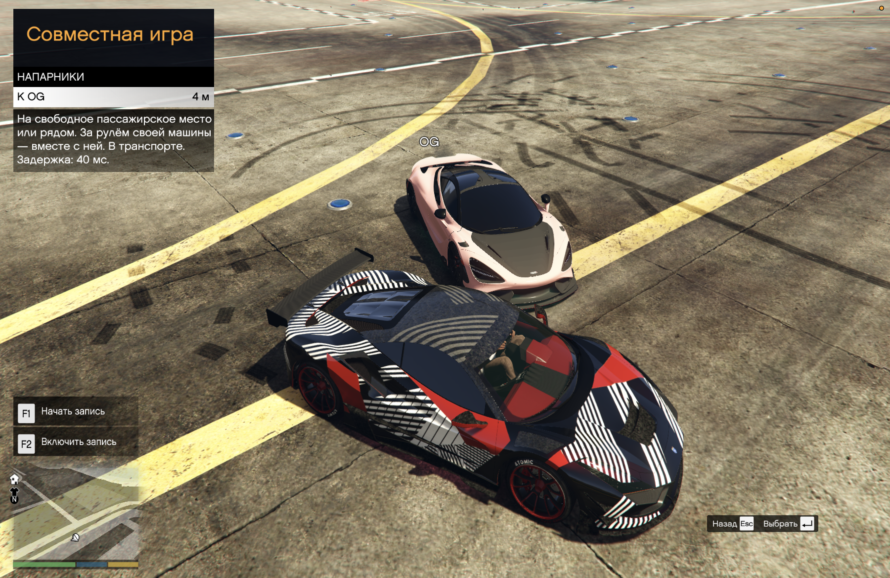

# RageCoop Toolkit

## 🇷🇺 Русский · [🇬🇧 Read in English →](README.md)

**Совместные поездки в GTA V Legacy и удобное меню для игры с друзьями.**

В разработке · MIT · Игровое меню пока на русском

**[Скачать v0.1.0-wip](https://github.com/vkupyansky/ragecoop-toolkit/releases/tag/v0.1.0-wip)** · [Исходники](https://github.com/vkupyansky/ragecoop-toolkit)

Неофициальное дополнение для [RageCoop](https://ragecoop.com/): транспорт, личный гараж, телепорты, общая погода и время, а также точечные исправления совместимой сборки RageCoop. За сам мультиплеер отвечает RageCoop.

### Что можно делать

- Искать и создавать обычные машины GTA, добавлять их в избранное и сохранять с тюнингом в гараже.
- Пользоваться Los Santos Customs; другие игроки видят внешний вид машины.
- Чинить транспорт с места водителя и пассажира, ставить на колёса и ускоряться удержанием клавиши.
- Перемещаться к метке и напарнику, в том числе на свободное пассажирское место.
- Делиться меткой, менять общую погоду и время суток.
- Выбирать оружие, пополнять патроны, управлять здоровьем, бронёй и способностями персонажа.
- Пользоваться клавиатурой и геймпадом; вводить русский и английский текст в поиске и названиях гаража.

Английское меню и переключатель языка запланированы отдельно.

### Состояние выпуска

**Выпуск в разработке: v0.1.0-wip.** Чистая сборка исходников и проверки запуска сервера прошли. Публичное меню проверено в GTA на Mac: поиск и создание машин, ремонт, ускорение, гараж, телепорт к метке, погода и время. Открытие меню геймпадом и ввод «з» также работают. Игра вдвоём проверена на частной установке. Чистая установка всего публичного клиента на Windows отдельно не подтверждена.

### Скриншоты

Настоящие кадры совместной игры вдвоём. Игровое меню пока на русском.


<details>
<summary>Меню, каталог машин, гараж и напарники</summary>

**Транспорт, телепорты и общие настройки**


**Каталог машин GTA**


**Сохранённые машины, цвета и тюнинг**



**Перемещение к напарнику**



</details>

### Установка

Поддерживается **GTA V Legacy 1.0.3889** на Windows. Этот кандидат не поддерживает Enhanced. Совместимые клиент и сервер RageCoop уже входят в ZIP дополнения; отдельно скачивать RageCoop не нужно.

**Подключиться к другу — Windows / VK Play**

Для SHVDN нужны .NET Framework 4.8 (уже входит в Windows 10/11) и [Microsoft Visual C++ v14 Redistributable, x64](https://learn.microsoft.com/en-us/cpp/windows/latest-supported-vc-redist). Если второго компонента нет, установите его.

1. Один раз откройте сюжетный режим и закройте GTA. Отключите BattlEye для сюжетного режима в Rockstar Games Launcher; для Steam/Epic есть официальный параметр запуска `-nobattleye`. [Инструкция Rockstar](https://support.rockstargames.com/articles/1nenwhZlVrJY6CTFeSS2Fx/grand-theft-auto-online-battleye-faq).
2. Установите [ScriptHookV 3889.0](https://www.dev-c.com/gtav/scripthookv/): из его папки `bin` перенесите `ScriptHookV.dll` и `dinput8.dll` рядом с `GTA5.exe`.
3. Скачайте [SHVDN 3.7.0-nightly.188](https://github.com/scripthookvdotnet/scripthookvdotnet-nightly/releases/tag/v3.7.0-nightly.188). Перенесите `ScriptHookVDotNet.asi`, `ScriptHookVDotNet2.dll` и `ScriptHookVDotNet3.dll` рядом с `GTA5.exe`. Существующий `ScriptHookVDotNet.ini` сохраняйте.
4. Распакуйте `RageCoop-Toolkit-Addon.zip`. Перенесите **содержимое** папки `client` рядом с `GTA5.exe`, сохраняя вложенные папки `scripts`. На VK Play все шаги выполняйте внутри виртуального ПК на постоянном игровом диске.
5. Полностью запустите GTA заново → сюжетный режим → **F9** → адрес сервера друга. Меню дополнения открывается на **J**.

Владелец сервера устанавливает серверную часть ниже. Само меню RageCoop загрузит при подключении.

**Запустить сервер для друзей**

1. Установите [**.NET 10 Runtime, x64**](https://dotnet.microsoft.com/en-us/download/dotnet/10.0), раздел **Run apps → .NET Runtime**; проверенная версия — 10.0.13.
2. Распакуйте ZIP и поместите его папку `server` туда, где разрешена запись. Это полный серверный пакет; GTA на сервере не нужна.
3. Windows: откройте `start-toolkit.cmd`. Linux/macOS: выполните `sh start-toolkit.sh` с x64 `dotnet` в PATH. Первый запуск создаст `Settings.xml` и сразу запустит сервер на UDP **4499**. Он не появляется в публичном списке. Играйте с доверенными людьми: общие инструменты доступны всем подключённым.
4. Передайте друзьям адрес: на компьютере с сервером — `127.0.0.1:4499`, в одной сети — локальный адрес сервера с `:4499`. Из другой сети перенаправьте UDP **4499** на сервер, разрешите его в брандмауэре и используйте внешний адрес владельца либо подходящую частную сеть. Для остановки — **Ctrl+C**.

Для обновления установленного Toolkit остановите сервер и замените файлы пакета, сохранив `Settings.xml` и данные игроков. В `Resources/Server/CoopAdmin` должна быть только `CoopAdmin.dll`. Входящие в пакет DLL RageCoop **1.5.12.15** закреплены в описи выпуска: другая nightly с тем же номером не обязательно совместима.

После обновления клиентских файлов или загружаемого меню полностью перезапускайте GTA. Одного переподключения через F9 может быть недостаточно.

### Управление

| Действие | Клавиатура | Xbox |
| --- | --- | --- |
| Меню дополнения | J | Удерживать LB + RB, нажать ↓ |
| Ремонт | K | Удерживать LB + RB, нажать ↑ |
| Выбрать / назад | Enter / Esc | A / B |
| Навигация | Стрелки | Крестовина |
| Ускоритель | Удерживать O | Не назначен |
| Меню GTA и карта | Esc | Menu / Start |

Во время ввода текста буквенные клавиши и редактирование принадлежат полю. Настройки, избранное и гараж сохраняются локально для сервера.

### Ограничения и следующие шаги

- Свободная совместная игра и общие инструменты; полного совместного сюжетного прогресса и общих катсцен нет.
- Радиостанция и её выключение передаются; точное место песни и личные музыкальные файлы — нет.
- Игровые подтверждения относятся к двум игрокам, а не нагрузочному тесту восьмерых. Измеренный прирост FPS и отсутствие любых вылетов не заявляются.
- Esc на Windows и остальные действия редактирования текста ещё требуют подтверждения. Холодный сбой автопроверки Win32-раскладки остаётся открытым, несмотря на работающий ввод в игре на Mac.
- Позже: английское меню и переключатель языка, продолжение независимых проверок стабильности, затем отдельные решения о заданиях и прочих механиках.

### Дополнительные машины

Модели ставятся отдельно у каждого игрока. Всем нужны одинаковые файлы и соответствующий каталог меню. Загрузка моделей и разрешения их авторов не входят в MIT-лицензию нашего проекта.

### Исходники и участие

В [изменениях основы](ENGINE_CHANGES.ru.md) перечислены подтверждённые проблемы проверенной сборки, исправления и границы доказательств. Это не утверждение о наличии этих ошибок во всех версиях RageCoop. Исправления применяет дополнение; оно не заменяет RageCoop новым движком.

Для сборки распакуйте ZIP исходников и ZIP дополнения. Установите SDK из `work/RageCoopAdmin/global.json` (**10.0.402**). Там же скопируйте `References.example.props` в `References.props`: `RageCoopClientDir` указывает на `client/scripts/RageCoop` дополнения, `RageCoopServerDir` — на `server`, `LemonUiDll` — на `lib/net48/LemonUI.SHVDN3.dll` из [LemonUI.SHVDN3 2.2.0](https://www.nuget.org/packages/LemonUI.SHVDN3/2.2.0). Из `work/RageCoopAdmin`:

```sh
dotnet restore Client/RageCoopAdmin.Client.csproj --locked-mode -p:PublicRelease=true -warnaserror
dotnet build Client/RageCoopAdmin.Client.csproj -c Release --no-restore -p:PublicRelease=true -warnaserror
```

Server, Bootstrap и EarlyClient собираются теми же locked restore/build командами. Из корня исходников `bash tools/check.sh --public-release` выполняет публичные сборки и целевые проверки в Windows/Git Bash либо macOS/CrossOver с .NET Framework 4.8. Эта команда не выполняет полный частный аудит и не запускает GTA. Известные ограничения и неуспешные проверки не скрываются.

Наш код — [MIT](LICENSE). RageCoop и остальные зависимости сохраняют собственные лицензии и авторство в [THIRD_PARTY.txt](THIRD_PARTY.txt). ScriptHookV скачивается у автора отдельно.
